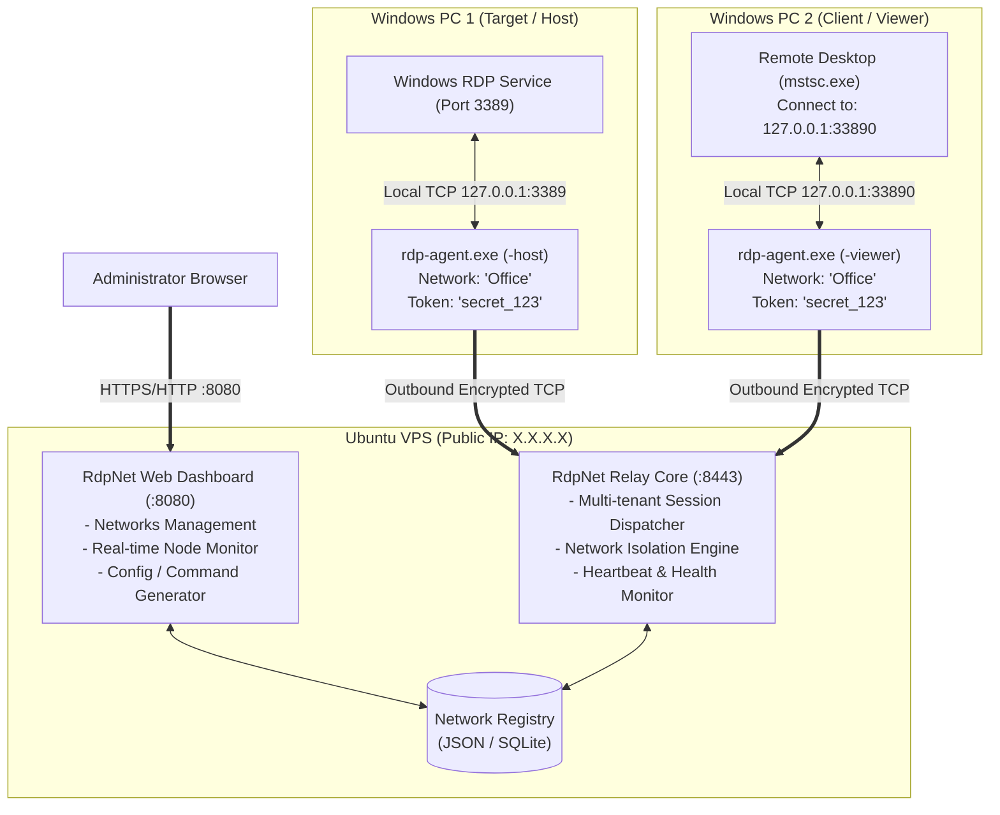

# RdpNet: Isolated Multi-Tenant RDP Tunnel with Web Management UI

**Date:** 2026-11-24  
**Status:** In Review  
**Target Architecture:** Windows Client (C++ / Win32 / ASM) + Ubuntu VPS Server (Relay Core + Web Management Dashboard)

---

## 1. Intent and The Why

The goal of **RdpNet** is to provide seamless, secure Remote Desktop (RDP) connectivity between computers over the internet behind NAT and firewalls, using an Ubuntu VPS as a coordination relay.

Unlike heavy VPN solutions (WireGuard, OpenVPN, ZeroTier) that require administrative privileges, kernel drivers (`wintun.sys`/`tap-windows`), virtual network interfaces, and IP routing configuration, RdpNet is purpose-built **specifically for RDP**:
1. **Zero-Driver, Zero-Admin:** Runs as a standard unprivileged user-mode application on Windows.
2. **100% NAT Traversal:** Both target (Host) and controlling (Viewer) machines establish outbound TCP connections to the VPS, effortlessly traversing strict corporate firewalls, NATs, and cellular connections.
3. **Multi-Tenant Network Isolation:** Users can create multiple completely isolated networks (e.g., "Office", "Home", "Production Servers"). Devices in Network A cannot see, access, or communicate with Network B.
4. **Web Management Dashboard on VPS:** A modern, intuitive browser-based UI to create networks, manage access tokens, inspect connected nodes in real time (status, ping, IP, uptime), and copy one-click launch commands or download configuration files.

---

## 2. Goals, Non-Goals, and Anti-Goals

### Goals
- **Multi-Network Support:** Arbitrary number of isolated virtual networks, each identified by a unique `NetworkID` and secured with a pre-shared authentication key (`AuthToken`).
- **Web UI on Ubuntu VPS:**
  - View real-time status of all networks and connected nodes.
  - Create, modify, and delete networks.
  - Generate connection parameters (ready-to-run CLI commands, `config.ini`).
  - Web UI password protection.
- **Native Windows Agent (`rdp-agent.exe`):**
  - Ultra-lightweight native executable (C++ / Win32 WinSock2).
  - Dual-mode:
    - **Host Mode (`-host`)**: Connects to VPS and forwards incoming tunnel sessions to local port 3389 (Windows Remote Desktop).
    - **Viewer Mode (`-viewer` or `-client`)**: Connects to VPS and opens a local port (e.g., `127.0.0.1:33890`) for `mstsc.exe` to connect to.
  - Automatic reconnection upon network interruptions.
  - Background/silent execution option.
- **End-to-End Security:**
  - Network-level isolation in the VPS relay.
  - Authenticated handshake prevents unauthorized access.
  - TLS/Encrypted channel options for data transmission.

### Non-Goals
- Full Layer-3 IP networking: RdpNet does not route ICMP pings, broadcast packets, or arbitrary network traffic outside of RDP streams.
- Direct P2P hole-punching (STUN/ICE): Relying on the VPS relay guarantees 100% reliability regardless of symmetric NAT or ISP carrier-grade NAT.

### Anti-Goals
- **No kernel-level drivers:** No installation of `wintun.dll`, OpenVPN TAP, or NDIS drivers.
- **No administrative requirements:** Normal user accounts can run the Windows client immediately.
- **No heavy client runtime:** No Electron, .NET runtime dependencies, or multi-megabyte frameworks on the Windows agent.

---

## 3. Approaches Considered & Trade-Offs

| Approach | Architecture | Admin / Driver Needed? | NAT Traversal | Multi-Network & Web UI | Decision |
|---|---|---|---|---|---|
| **Approach 1: Reverse TCP Relay + Web UI (RdpNet)** | Outbound TCP from Host & Viewer to VPS relay; Web UI on VPS | **NO (100% user-mode)** | **100% guaranteed** (Outbound TCP) | Native rooms/tokens; lightweight web dashboard | **SELECTED** (Fits all user requirements perfectly) |
| **Approach 2: Wintun L3 VPN (WireGuard/ZeroTier clone)** | Virtual network adapter on Windows (`10.x.x.x`), kernel driver | **YES (Admin & driver required)** | High (UDP hole punch / relay) | Complex routing & subnet assignment | **REJECTED** (Overkill for RDP, requires driver install) |
| **Approach 3: Direct P2P NAT Traversal (STUN/TURN)** | Direct UDP connection between endpoints | No | Fragile (Fails on symmetric / mobile NAT) | Requires complex signaling & STUN servers | **REJECTED** (Unreliable without VPS relay fallback) |

---

## 4. Architecture and Component Breakdown



---

## 5. Protocol Specification & Network Isolation

### 5.1 Framing Protocol (Binary Header)
All communication over the relay control/data sockets uses a lightweight binary packet frame:

```
+---------------+---------------+--------------------+------------------------+
| Magic (2B)    | MsgType (1B)  | PayloadLen (2B)    | Payload (N bytes)      |
| 0x52 0x4E     | (see types)   | Big-Endian uint16  | JSON or Raw Stream     |
+---------------+---------------+--------------------+------------------------+
```

- **Magic**: `0x52 0x4E` ('RN' - RdpNet)
- **MsgType**:
  - `0x01` `MSG_HELLO` (Agent -> Server): Registration (`network_id`, `auth_token`, `role`, `node_name`)
  - `0x02` `MSG_WELCOME` (Server -> Agent): Registration result (`status`, `session_id`, `error_msg`)
  - `0x03` `MSG_HEARTBEAT` (Agent <-> Server): Keep-alive ping/pong
  - `0x10` `MSG_TUNNEL_REQUEST` (Viewer -> Server): Request connection to Host in same network
  - `0x11` `MSG_TUNNEL_ASSIGN` (Server -> Host): Server notifies Host of incoming viewer session
  - `0x12` `MSG_TUNNEL_READY` (Host -> Server): Host opened local RDP bridge and is ready
  - `0x20` `MSG_DATA` (Bi-directional): Encrypted RDP payload stream

### 5.2 Network Isolation Guarantee
1. **Network Table:** The server maintains an in-memory map of `networks[network_id] -> { name, secret, hosts: [], viewers: [] }`.
2. **Registration:**
   - When a node connects, it must provide `network_id` and `auth_token`.
   - If `auth_token` does not match the network's secret, the connection is instantly terminated (`403 Unauthorized`).
3. **Strict Namespace Routing:**
   - A Viewer registered in `network_id = "office"` can ONLY discover and tunnel to Hosts registered in `network_id = "office"`.
   - The relay dispatcher checks `host.network_id == viewer.network_id` on every connection attempt. Cross-network routing is physically impossible in the code.

---

## 6. Web Management Interface (Ubuntu VPS)

The Web UI is a modern single-page dashboard served directly by the server daemon:

1. **Dashboard Overview:**
   - Active Networks counter, Total Online Nodes (Hosts / Viewers), Bandwidth / Active Sessions.
2. **Networks Manager:**
   - Table of all networks: Name, Network ID, Key (masked with reveal button), Connected Hosts count, Viewers count.
   - Button **"Create Network"**: Generates a random secure token and unique ID (or allows custom name).
   - Button **"Delete Network"**: Safely removes network and disconnects associated nodes.
3. **Live Devices / Nodes View:**
   - List of all online agents:
     - Network
     - Node Name (e.g., "Accounting-PC-1")
     - Role (Host / Viewer)
     - Remote IP & Country
     - Ping / Latency
     - Online duration
4. **Quick Connect / One-Click Setup Modal:**
   - Clicking "Connect Device" displays:
     - For Host:
       ```cmd
       rdp-agent.exe -server <VPS_IP>:8443 -net <NET_ID> -key <KEY> -host -name "Work-PC"
       ```
     - For Viewer:
       ```cmd
       rdp-agent.exe -server <VPS_IP>:8443 -net <NET_ID> -key <KEY> -viewer
       ```
     - Button: **Download `rdp-agent.ini`** (pre-configured file).

---

## 7. Windows Client (`rdp-agent.exe`) Specification

- **Language / Runtime:** C++ / WinSock2 (or FASM x64), zero external runtime DLLs required.
- **Size:** Under 100 KB single standalone `.exe`.
- **Modes:**
  - **Host Mode:**
    - Reads config or CLI args: `-server <IP:Port>`, `-net <NetID>`, `-key <Key>`, `-host`, `-name <NodeName>`.
    - Establishes connection to VPS, registers in network.
    - Listens for VPS tunnel creation requests.
    - Spawns asynchronous stream forwarding between VPS tunnel socket and `127.0.0.1:3389`.
  - **Viewer Mode:**
    - Reads config or CLI args: `-server <IP:Port>`, `-net <NetID>`, `-key <Key>`, `-viewer`, `-local <LocalPort>`.
    - Starts local listener on `127.0.0.1:<LocalPort>` (default `33890`).
    - When user launches `mstsc.exe 127.0.0.1:33890`, the agent opens a tunnel through the VPS to the Host.
  - **Features:**
    - Automatic reconnection loop (reconnects within 3 seconds on disconnect).
    - Optional `-tray` mode for silent system tray execution.
    - Configuration file `rdp-agent.ini` support alongside command-line arguments.

---

## 8. Deployment on Ubuntu VPS

A single automated deployment script `install_vps.sh`:
- Installs dependencies (if any).
- Sets up systemd service `/etc/systemd/system/rdpnet.service`.
- Opens required firewall ports (`ufw allow 8443/tcp; ufw allow 8080/tcp`).
- Starts service on boot.
- Displays the Web UI URL and initial admin credentials in terminal output.

---

## 9. Verification & Quality Assurance Plan

1. **Protocol & Network Isolation Tests:**
   - Verify nodes with wrong tokens are rejected.
   - Verify Viewer in Network A cannot connect to Host in Network B under any circumstance.
2. **Relay Throughput & Latency Tests:**
   - Test bi-directional RDP data transfer with simulated packet streams.
   - Verify clean disconnect and resource cleanup when RDP session ends.
3. **Reconnection Tests:**
   - Kill relay server and restart: verify Windows clients reconnect automatically without crash.
4. **End-to-End Test:**
   - Complete live connection test with standard Windows RDP client (`mstsc.exe`).
